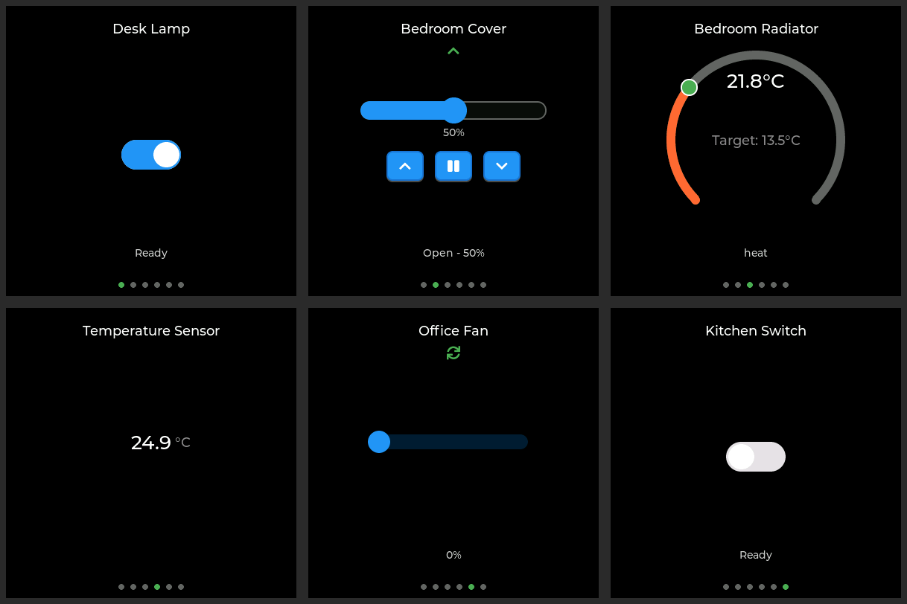
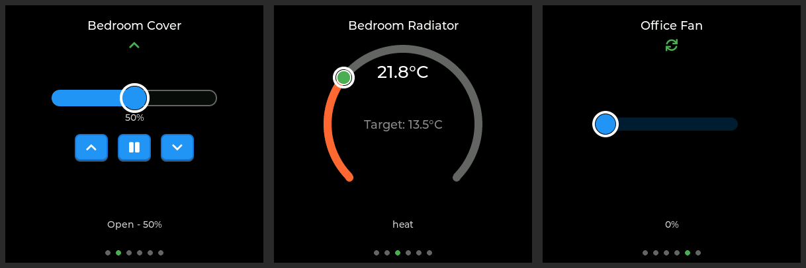

# Plan: UI upgrade (dark, AMOLED-first, Home Assistant-like but minimal)

Status: mockups approved. Phase 0, 1, 1b and 2 done (1b: 80 MHz bus, one 78-row draw buffer, REST sync one entity per loop; swap went from 7-8 fps to 28-41 fps, longest loop stall 130-155 ms to 32-41 ms) (LVGL heap after UI: 35516 of 49152 bytes free, biggest block 35516, measured after Phase 1; no pre-Phase-1 baseline was recorded).

Related plans: [PLAN_light_brightness.md](PLAN_light_brightness.md) (after Phase 3), [PLAN_runtime_config.md](PLAN_runtime_config.md) (independent, see "Start here").

## Start here (for the session that implements this)

1. **Visual source of truth: [ui-upgrade/mockups.html](ui-upgrade/mockups.html)** (approved). Open it in a browser. Its inline JS holds the exact geometry in device pixels (390x390, center 195,195; ring radius 175, stroke 12 / 18 in edit mode, 270 degrees with the gap at the bottom, start angle 135; disc radius 64; dot radius 172 at 7 degree spacing; text baselines per tile in `toggleTile`, `coverTile`, `thermoTile`, `sensorTile`, `fanTile`). Where this document and the mockup disagree, the mockup wins; tell the owner and fix the document. The icons in the mockup are hand-drawn placeholders: the real ones come from the MDI font (see Icons).
2. **Current UI for comparison**: [ui-upgrade/screenshots/](ui-upgrade/screenshots/). Regenerate "after" shots with the same tool (Phase 0) and keep before/after pairs in the PR.
3. **Hardware and workflow facts**: read `AGENTS.md` (device is the SH8601 + CHSC5816 variant, PSRAM unusable, 48K LVGL heap, build with `venv/bin/pio run`, upload with `-t upload --upload-port /dev/cu.usbmodem*`, device IP is printed on Serial, screenshots at `http://<ip>/screenshot.bmp`). Two USB serial ports may show up; the device is the "USB JTAG/serial debug unit".
4. **The debug tile route was only temporary and is not in the tree.** Recipe, to be made permanent in Phase 0 behind `ENABLE_SCREENSHOT_SERVER`: in `port/screenshot.cpp` register `server.on("/tile", HTTP_GET, ...)` that reads `i` and an optional `edit` argument and calls a hook `debugGoToTile(int index, bool edit)`; the sketch implements it as `exitEditMode(); navigateTiles(index - currentTileIndex); if (edit && isAdjustable(type)) enterEditMode();`. The owner's entity list has no fan or switch, so for full coverage add them temporarily to `entities.h` (they will not exist in HA and just show defaults); do not commit that.
5. **Order**: Phase 0, 1, 1b, 2, 3, 4, 5. Phase 1b (performance) must land before the ring tiles. One phase per PR; each PR carries before/after screenshots and, for 1b, the measurement table.
6. **Do not** change the input model, `updateEntityTile()` sync rules, WebSocket/REST handling or the screenshot server's protocol, and keep LVGL calls on the main task (AGENTS.md rules apply).
7. **Interaction with the runtime-config plan**: entities may become runtime-defined later. Anything that depends on the entity count (dots vs `n / N`, indicator arc) must read `ENTITY_COUNT` or its runtime replacement through one accessor, decided once when the UI is built, not hardcoded.
8. **When finished**: update the input-model and UI notes in `AGENTS.md`, the README screenshots, and mark this plan done.

## Goals
- Modern, minimal look that reads as Home Assistant: a big state-colored icon, the entity name, a one-word state.
- Dark by design. The panel is AMOLED and always on, so true black (`#000000`) is the background and bright pixels are kept to a few small shapes.
- Designed for the 390x390 **round** panel: nothing that matters outside the inscribed circle.
- Same input model (encoder rotate / press / long press, touch in parallel). This plan changes looks, not behavior.

## How the current UI was captured

Screenshots come from the screenshot server (`port/screenshot.*`, `GET /screenshot.bmp`). To avoid touching the knob, a **temporary** debug route `GET /tile?i=<n>[&edit=1]` was patched in (it called `navigateTiles()` / `enterEditMode()` through a small hook), and a fan and a switch were added to `entities.h` because the owner's list has none. Those patches were reverted; the device runs the normal firmware. Images are masked to the round shape with ImageMagick (`magick in.bmp mask.png -alpha off -compose multiply -composite out.png`, mask = white circle r=195 on black).

Suggestion for Phase 0: keep the `/tile` route permanently behind `ENABLE_SCREENSHOT_SERVER`, so UI work is always testable remotely (see Testing).



Edit mode (encoder press on cover, thermostat, fan):



Individual frames are in [ui-upgrade/screenshots/](ui-upgrade/screenshots/) (`0_light`, `1_cover`, `2_thermostat`, `3_sensor`, `4_fan`, `5_switch`, `*_edit`).

## Analysis of the current UI

Cross-cutting:
- **Stock LVGL default look.** Material-blue (`#2196F3`) switch/slider/buttons, green icons, grey dots. It reads as a demo, not as Home Assistant. Colors are not tied to state.
- **Layouts are not designed for a circle.** Everything is laid out as for a square: titles at `y=10` (top chord is only ~170 px wide there, and "Temperature Sensor" (~185 px at 18 pt) touches the bezel), a status line at the bottom, controls in a column. Large dead areas left and right.
- **Three fonts only** (Montserrat 14/18/26). Hero values (temperature, position) are 26 px, so the key number is barely larger than the title. No room for hierarchy.
- **Icons are LVGL built-in symbols** (`LV_SYMBOL_*`): an eye for a light, a loop for a thermostat, an up arrow for a cover. They do not match HA's MDI icons the entity config already refers to (`mdi:lightbulb`, `mdi:blinds`).
- **State is not visible at a glance.** Light on/off differs only by the knob position of a small switch.
- **Brightness of static content.** Pure white title, bright blue controls and green dots are permanent, large lit areas: burn-in risk on an always-on panel.

Per tile:

| Tile | Findings |
|---|---|
| Toggle (light, switch) | **The icon is missing**: a blank gap above the switch. `createToggleTile` reads `entity.icon` at build time, but the default icon is only filled in later (`ensureEntityIcon` in the WebSocket manager), so the label gets `LV_SYMBOL_DUMMY`. Cover shows its icon only because `entities.h` sets `mdi:blinds` explicitly. The 80x40 switch is small for a round face; "Ready" in the status line carries no information. Light on = blue switch, which is the opposite of HA's amber. |
| Cover | Slider, percent, three buttons and a status line stack into a column that runs into the circle edge at the slider ends (250 px wide at `y=-40`). The percent label overlaps the slider's lower edge. Redundant: the status line repeats the percent ("Open - 50%"). Edit mode only adds a white knob ring, which is easy to miss. |
| Thermostat | The best tile: an arc suits the round display. But the arc is a 240 px 270-degree arc with the knob in the top left, the current temperature is cramped under the arc top, "Target: 13.5°C" is grey on black at low contrast, the HVAC mode is a bare lowercase word ("heat"). Orange arc is fixed regardless of mode. Edit mode again only adds a knob ring. |
| Sensor | Value is 26 px with a tiny unit, centered with a lot of empty space. The title is wide and sits in the clipped top zone. No icon is shown (same icon timing issue). |
| Fan | Slider is thin, almost invisible in dark blue; knob alone shows the value; the speed label is at the very bottom. The fan icon is a static refresh symbol. |
| Indicator dots | 6 dots at `y=LV_VER_RES-30..` are fine in principle, but they are a straight row near the bottom chord, and grey `#666` dots are among the brightest static pixels on screen. With many entities the row gets wide. |

## Design language

### Principles
1. **One idea per screen**: icon, name, state, and one control. Nothing else.
2. **Color means state.** Inactive = dim grey on black. Active = HA's accent for the domain. Never blue-by-default.
3. **Use the circle**: arcs and rings instead of rectangles; the control follows the bezel.
4. **Black wins**: background `#000000`, no panels, no gradients, no borders. Shapes are drawn with arcs and filled circles.
5. **Low static brightness**: accent colors are at 70-85% of full brightness; white is used only for the hero value, never for large fills.

### Tokens (put in one `ui_theme.h`)

| Token | Value | Use |
|---|---|---|
| `BG` | `#000000` | screen and tiles |
| `SURFACE` | `#16181B` | idle icon disc, inactive arc track |
| `TEXT` | `#E6E6E6` | hero value |
| `TEXT_DIM` | `#8A8F98` | name, secondary text (contrast vs black: ~6:1) |
| `INACTIVE` | `#4A4F57` | icon when off |
| `ACCENT_LIGHT` | `#FFB300` | light/switch/fan on (HA amber) |
| `ACCENT_HEAT` | `#FF7A1A` | climate heating |
| `ACCENT_COOL` | `#3FA7FF` | climate cooling |
| `ACCENT_COVER` | `#42A5F5` | cover |
| `ACCENT_OK` | `#4CAF50` | sensor/positive state |
| `ERROR` | `#E5484D` | unavailable / call failed |

Colors are RGB565 on this build (`LV_COLOR_DEPTH 16`), so keep tokens flat; smooth gradients will band.

### Type scale

Currently enabled: Montserrat 14, 18, 26. Proposed (flash cost roughly 20-40 KB per size, check against the 16 MB partition, which has room):

The approved mockups use hero sizes of 56 and 64 px, but LVGL's built-in Montserrat stops at 48. Decision: **the standard hero is 56**, so only two custom digits-only fonts (56, 64) are needed and the built-in 48 is not enabled.

| Role (where used in the mockups) | Size | Source |
|---|---|---|
| Hero, large (thermostat current temperature, sensor value) | 64 | custom digits-only font, see below |
| Hero, standard and edit mode (cover and fan percent, light brightness) | 56 | custom digits-only font |
| Thermostat target / secondary value | 26 | existing |
| Name, unit | 18 | existing |
| Caption (state, hints, `n / N`) | 14 | existing |
| Small icons (tile header icons, sensor icon) | about 36 | MDI subset font |
| Disc icon | 64 | MDI subset font |

Custom digits-only fonts: generate with `lv_font_conv` from the Montserrat TTF, glyph set `0123456789.-+ °%/` (about 16 glyphs), 4 bpp, at 56 and 64. That is a few KB each instead of the 20-40 KB of a full size. Commit the generated C files with the exact command in a comment. The sensor unit in the mockup is 22 px; use 18 (not worth a font). Texts that are not digits (names, states) only use the existing 14/18/26 fonts. A value such as `Unavailable` or `N/A` in a hero slot must fall back to 26.

### Icons

Generate a small icon font from the Material Design Icons webfont (the same MDI names HA uses), with `lv_font_conv`, committed as a C file in `port/` or `assets/`. Subset (~16 glyphs): `lightbulb`, `lightbulb-outline`, `light-switch`, `toggle-switch`, `power-plug`, `blinds`, `blinds-open`, `window-shutter`, `garage`, `fan`, `thermostat`, `thermometer`, `water-percent`, `gauge`, `flash`, `help-circle`. Map `mdi:<name>` to a codepoint in `getDisplaySymbol()`, keeping the existing fallback. Also fixes the missing-icon bug (resolve the icon at update time, not at tile creation, or call `ensureEntityIcon` in `createEntityTile`).

### Safe area on the round panel

Half-width of the circle at distance `d` from the center is `sqrt(195² - d²)`. Use these as the layout contract:

| Zone (as in the approved mockups) | `y` baseline | Usable width |
|---|---|---|
| Name, tiles without a ring (light, switch) | 74 | ~190 px |
| Name, tiles with a ring (cover, thermostat, fan, dimmable light) | 98 | ~270 px |
| Hero | 205-232 | ~340 px |
| State / caption | 252-304 | ~260 px |
| Dots, `n / N` | on the arc at r=172 (bottom), `n / N` at 362 | ~170 px |

Names longer than the width above must be shortened with `LV_LABEL_LONG_DOT` (single line, fixed width), never wrapped. Rules: no text above `y=48`; keep the main control inside a 300 px circle; use `LV_ALIGN_*` against the tile center and a `UI_SAFE_*` constant block rather than raw offsets.

## Tile designs

All sketches are the 390 px round face. Icon "disc" = 128 px circle (64 px icon).

### Toggle (light, switch, input_boolean)
```
          Desk Lamp            name, 18 pt, TEXT_DIM
       .-------------.
      /    (  💡  )   \         128 px disc, 64 px MDI icon
     |   on: amber disc |       on: disc ACCENT_LIGHT at ~15% fill, icon ACCENT_LIGHT, thin ACCENT ring
      \  off: SURFACE   /       off: SURFACE disc, icon INACTIVE
       '-------------'
              On               state, 14 pt (On / Off / Unavailable)
```
- The whole disc is the touch target (replaces the small switch); encoder press toggles as today.
- On/off animation: 150 ms color + ring opacity fade (`lv_anim`), no layout motion.
- Brightness (arc around the disc, encoder edit mode) is a separate plan: [PLAN_light_brightness.md](PLAN_light_brightness.md). This tile must leave room for it: keep the disc at 128 px and reserve a 270-degree ring at radius 175 (same as the cover and fan).

### Cover
```
         Bedroom Cover
        .-------------.
       /  50% hero 56   \       hero: position, TEXT (accent in edit mode)
      |   open / closing  |     state, 14 pt, ACCENT_COVER
       \  arc 0-100%    /       270-degree ring around the face, ACCENT_COVER indicator
        '-- ^  ||  v --'        three round 56 px buttons in a row at the bottom chord
```
- Replace the horizontal slider with a ring slider (`lv_arc`), a 10 px track in `SURFACE`, indicator in `ACCENT_COVER`.
- Real position vs target: the ring shows the *real* position; a short orange tick (3 px arc segment) marks the target while they differ (replaces the second hidden slider).
- Buttons: filled circles with MDI/symbol glyphs, `SURFACE` fill, glyph `TEXT_DIM`; pressed = accent. The stop button highlights during motion.
- Edit mode: ring thickens 12 to 18 px and the hero value turns accent color (clear, not just a knob ring).

### Thermostat
```
        Bedroom Radiator
       .---------------.
      /  21.8°  hero 64  \      current temperature, TEXT
     |   -> 13.5°  26    |      target, mode accent color
      \  heating (dot)  /       state 14 pt: "Heating", "Idle", "Off", with a colored dot
       '-- arc 270° ----'       ring follows bezel, knob 22 px
```
- Arc moves out to the bezel (radius ~175 px, 14 px stroke), which frees the center for large numbers.
- Indicator color follows `hvacAction`: heating `ACCENT_HEAT`, cooling `ACCENT_COOL`, idle/off `INACTIVE`.
- A small tick on the track marks the current temperature next to the target knob, so the gap is visible.
- Edit mode: target number scales up (26 to 64 pt) and current temperature goes to caption size; reverts on exit.

### Sensor
```
          Temperature
            🌡  26 pt icon, INACTIVE/ACCENT_OK
           24.9 °C           hero 64 + unit 18 dim
        updated 2 min ago     optional, 14 pt, TEXT_DIM
```
- Pure read-only: no ring, no controls. Value tinted only when it is meaningful (e.g. temperature gradient) in a later phase.

### Fan
Ring slider like the cover (accent `ACCENT_LIGHT`), hero = percent, a rotating MDI fan icon while speed > 0 (rotation by an `lv_anim` on an image transform needs the icon as an image, so use a 3-state static glyph: off / slow / fast as an acceptable first version).

### Indicator dots
- Replace the straight row with **dots on an arc along the bottom bezel** (radius ~170 px) so they follow the circle and use the same chord math for any count.
- Inactive: `#2A2D32` (barely visible), active: `TEXT_DIM`, 6 px. Active dot is not a bright accent.
- More than `UI_DOTS_MAX` (12) entities: dots are replaced by a `n / N` caption (14 pt, `TEXT_DIM`, same spot, e.g. `3 / 14`). 12 dots at 7 degrees span 77 degrees of the bottom bezel; more would crowd the cover buttons and the toast. The threshold is one constant and the choice is made once at UI build time.

### Toast and overlays
- Toast: pill, `SURFACE` background, `TEXT` 14 pt, bottom chord (`y~310`), fade 150 ms.
- WiFi overlay: black, centered spinner with a thin 3 px arc in `TEXT_DIM`, one line of status text. No blue/green mix.
- Error/unavailable: icon `ERROR`, state text "Unavailable"; the tile still scrolls and works.

## AMOLED care (always on)

- **Idle dimming (decided: fixed low level)**: after a timeout without input the panel drops to one fixed low brightness (`gfx->Display_Brightness()`, already used for the boot fade-in in `port/lv_port_disp.cpp`). Any encoder or touch input restores the active level. The wake input is consumed only if it is a rotation or press that also changes something; a touch on a dimmed screen first only wakes it (no accidental toggle). Fade over ~300 ms in both directions.
- **Settings** in a new `ui_config.h` (safe defaults, each wrapped in `#ifndef` so they can be overridden in `ha_config_private.h` or with `-D` flags):

```
#define UI_BRIGHTNESS_ACTIVE   255   // 0-255, level while in use (default: the level the boot fade ends on)
#define UI_DIM_ENABLED         1
#define UI_DIM_LEVEL           40    // 0-255, fixed idle level (~15%)
#define UI_DIM_TIMEOUT_S       30    // seconds without input; 0 disables dimming
#define UI_DOTS_MAX            12    // above this the dots become "n / N"
```

- The dim logic (state machine: ACTIVE, DIMMING, DIM, WAKING; inputs: now, last-input time, config) is pure and lives in an Arduino-free header `port/idle_dimmer.h` with unit tests (timeout, wake, 0 = disabled, millis wraparound). The sketch only applies the level it returns.
- No deep-idle or panel-off mode for now; revisit if the dim level still shows burn-in.
- **Pixel shift**: shift the whole tileview by +/-1-2 px every few minutes (on the main screen container), so static edges do not burn.
- No large bright fills, no white outlines, no fully static bright elements other than the icon and hero value.
- Avoid full-screen redraws on idle (LVGL only redraws invalidated areas; keep animations short and finished so the CPU can sleep).

## Rendering performance (page-swap lag)

Swiping or turning to the next tile sometimes stutters. This is read from the code, **not yet measured on the device**; Phase 1b starts with measurements so the fixes are chosen from numbers.

Likely causes, most to least important:
1. **Display bus at 8 MHz.** `lv_port_disp.cpp` creates `Arduino_ESP32QSPI` without a speed, so it uses `QSPI_FREQUENCY 8000000` (Arduino_GFX 1.3.7). Four data lines at 8 MHz is about 4 MB/s at best; a full frame (390 x 390 x 2 bytes, about 304 KB) needs at least 76 ms, so a full-screen repaint is capped near 13 fps and is lower in practice. A tile swap scrolls the whole screen, so every animation frame is a full repaint.
2. **Synchronous flush, tiny buffers.** The two draw buffers are 10 rows each (39 flushes per full frame, each with its own address-window setup), and `disp_flush` blocks until the transfer is done, so the second buffer gives no overlap between rendering and sending.
3. **Main loop stalls.** WiFi, WebSocket and REST all run in `loop()`; the REST client has a 2 s timeout, so a slow fetch can freeze the UI for that long. This fits the "sometimes" in the symptom.
4. **Scroll animation cost.** The default tileview scroll animation moves two full tiles per frame.

Fixes, cheapest first (each is measured before and after, kept only if it helps):

| Step | Change | Risk |
|---|---|---|
| a | Pass a higher speed to `Arduino_ESP32QSPI` (try 20, 40, 80 MHz) | The panel or wiring may show artifacts at high speed; test each |
| b | Larger draw buffers (about 40 rows, about 31 KB each) | Internal RAM budget (48K LVGL heap is separate); check free heap |
| c | Asynchronous flush: DMA transfer with `lv_disp_flush_ready()` called from the completion callback, so rendering overlaps sending | Largest change; Arduino_GFX 1.3.7 has no async path, so it needs the ESP-IDF SPI master / `esp_lcd` API |
| d | Cheaper page change: shorter scroll (150-200 ms), or a short fade instead of a slide | Design call, check the look |
| e | Keep REST off the interactive path: shorter timeouts, one request per loop (already), or run it in a separate task | Threading: LVGL stays on the main task, network results go through the existing queues |

Measure first: wrap `disp_flush` and the LVGL render with `micros()`, print per-frame render time, flush time, pixels sent and `loop()` gaps over Serial during a tile change; optionally enable `LV_USE_PERF_MONITOR` for a temporary on-screen FPS counter. Targets: swap animation at 30 fps or better, no `loop()` gap above 50 ms during a swipe.

The new ring-based tiles are heavier to draw than the current ones, so this phase comes before the cover, fan and thermostat redesign.

## Technical notes and constraints
- **Memory**: `LV_MEM_SIZE` is 48K and PSRAM is not usable. Prefer shapes (arcs, circles, labels) over images; no full-size image buffers. Each size of a Montserrat font and the icon font lives in flash, not RAM. Budget check after each phase with `lv_mem_monitor` printed once on Serial.
- **LVGL 8.3.5**: arcs with rounded caps and `lv_anim` are available (`LV_DRAW_COMPLEX 1`). `lv_obj_set_style_transform_*` exists but rotating labels/fonts is costly, so avoid it.
- **Rendering cost**: ring/arc redraws on a 390x390 QSPI panel are the heaviest operation. Keep arcs at 10-16 px stroke, animate by changing the value only, and keep the existing 5 ms main loop. See "Rendering performance" above.
- **Do not change** the input model, entity struct semantics, `updateEntityTile()` sync rules (`userHoldsControl`), or the screenshot server.
- **Refactor needed first**: tile creation lives in one 1200-line `.ino`. Split UI into `ui_theme.h` (tokens, styles), `ui_tiles.cpp` (create/update per type) and keep logic in the existing Arduino-free headers, so the UI can be reviewed in isolation.

## Phases

| Phase | Scope | Done when |
|---|---|---|
| 0 | Tooling: make `/tile?i=&edit=1` permanent in the screenshot server (behind the existing macro); add a script `tools/screenshots.sh` that captures all tiles and writes masked PNGs | one command regenerates the sheets in this doc |
| 1 | Foundations: `ui_theme.h` tokens, custom 56/64 digits font, MDI icon font (real glyphs replace the mockup's placeholders), icon timing bug fix, safe-area constants, split UI code out of the `.ino` | toggle/sensor icons appear, no visual regressions |
| 1b | Rendering performance: instrument flush/render timing, then steps a-e in "Rendering performance" (bus speed, buffers, async flush, cheaper page change, REST off the interactive path) | measured before/after table in the PR; swap at 30 fps or better, no loop gap above 50 ms while swiping |
| 2 | Toggle + sensor + dots: new disc layout, state colors, arc dots, toast | before/after screenshots committed |
| 3 | Cover + fan ring sliders, thermostat ring and mode colors, new edit-mode look | encoder and touch behavior unchanged (manual check) |
| 4 | AMOLED care: `ui_config.h`, `idle_dimmer.h` + tests, idle dim with fixed level, pixel shift; "updated x ago" for sensors; dot-to-`n / N` switch | dim timeout and level follow the config, wake does not toggle, verified on device |
| 5 | Polish: animations (150 ms), unavailable states, WiFi overlay restyle, README screenshots | |

## Testing
- Unit tests (`pio test -e native`) cover any new pure logic (e.g. ring value mapping, state to color selection, dot positions on an arc) kept in Arduino-free headers.
- Visual: after each phase run the screenshot script, put the new sheet next to the old one in the PR.
- On device: encoder rotate, press, long press, edit-mode timeout, touch drag on arcs, swipe between tiles, WiFi drop (overlay), HA unavailable state.
- Memory: free LVGL heap printed on Serial must stay comfortably above the current baseline (record it before Phase 1).

## Decisions
- **Cover buttons stay** (open, stop, close). Touch users need them; the encoder path (press to edit, long press to stop) is unchanged.
- **Indicator**: dots up to `UI_DOTS_MAX`, `n / N` caption beyond that.
- **Light brightness**: its own plan, [PLAN_light_brightness.md](PLAN_light_brightness.md). Not part of the phases above.
- **Dimming**: one fixed low level, with level and timeout set in `ui_config.h` (see AMOLED care).
